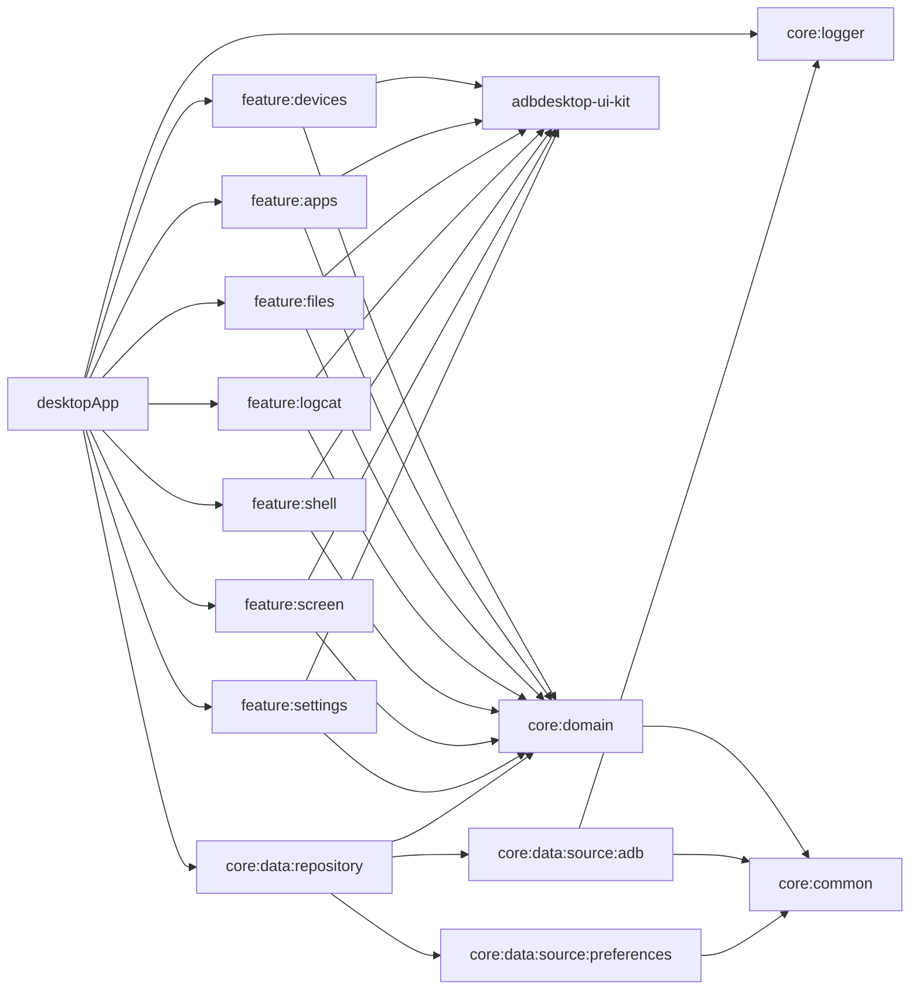

# ADB Desktop

A desktop GUI for `adb`, built with Compose Multiplatform for Windows, macOS and Linux.

- **Devices**: live list over USB, emulator and Wi-Fi with battery and CPU usage, connect, pair and disconnect over
  Wi-Fi, including devices discovered on the network.
- **Apps**: browse and filter packages, see details, open, force stop, clear cache or data, uninstall, install APKs.
- **Files**: browse the device, upload, download, delete and create folders.
- **Logcat**: live stream with level and text filters, pause and clear.
- **Shell**: interactive session with command history.
- **Screen**: screenshots and screen recording.
- **Settings**: choose the adb executable and the theme.

Actions apply to the device picked in the sidebar. See [docs/ROADMAP.md](docs/ROADMAP.md) for what comes next.

## Requirements

- **JDK 17 or newer** to run Gradle. The build provisions the JDK 21 toolchain it compiles and runs with.
- **Android platform-tools** (`adb`). It is found through, in order: the path set in the app, `ANDROID_HOME`,
  `ANDROID_SDK_ROOT`, then `PATH`.
- **An Android SDK** (`ANDROID_HOME`, or `sdk.dir` in `local.properties`). Only the build needs it: Compose modules
  carry an Android target so IDE previews render ([ADR 2](docs/adr/0002-preview-only-android-target.md)).

## Run

```bash
./gradlew :desktopApp:run                              # run the app
./gradlew :desktopApp:hotRun --auto                    # run with Compose Hot Reload, reloading on save
./gradlew :desktopApp:packageDistributionForCurrentOS  # build a native installer (dmg, msi or deb)
```

Keyboard shortcuts: `Ctrl+1` to `Ctrl+7` open the sections in sidebar order (`Cmd` on macOS).

## Check

```bash
./gradlew check            # ktlint, detekt (with compose-rules), module graph rules and all tests
./gradlew ktlintFormat     # fix formatting
./gradlew checkModuleGraph # dependency direction only
```

To also run the real app graph against a device or emulator (`check` itself never needs one):

```bash
ADB_TEST_SERIAL=emulator-5554 ./gradlew :desktopApp:test --rerun --tests '*DeviceIntegrationTest'
```

`./gradlew check` must pass before every commit. The build installs two git hooks: `pre-commit` runs
`ktlintFormat`, `commit-msg` enforces [Conventional Commits](https://www.conventionalcommits.org).

## Known Android limits

- **Clear cache** only works on debuggable apps. Android does not let adb clear another app's cache, so the app uses
  `run-as` and reports the reason when the device refuses.
- **Data and cache sizes** need a recent Android version; older ones show them as unknown.
- **Screen recording** stops after 3 minutes, which is Android's limit.

## Continuous integration

- [`ci.yml`](.github/workflows/ci.yml) runs `./gradlew check` once on Linux for pushes to `main` and for pull
  requests. On macOS and Windows it runs only the specs tagged `platform`, which cover the code that depends on the
  host (finding and running executables, the preferences store):
  `./gradlew :core:data:source:adb:jvmTest :core:data:source:preferences:jvmTest -Pkotest.tags=platform`.
- [`package.yml`](.github/workflows/package.yml) builds the deb, dmg and msi on their native runners when a `v*` tag
  is pushed, or on demand, and uploads them as artifacts.

## Modules



| Module | Responsibility |
|---|---|
| `desktopApp` | Entry point, window, keyboard shortcuts, navigation host, DI graph |
| `adbdesktop-ui-kit` | Design system: `AppTheme`, tokens, closed feature-agnostic components, previews |
| `feature:*` | One screen each: MVI contract, ViewModel as reducer, stateless content |
| `core:domain` | Models, repository interfaces and use cases. Pure Kotlin |
| `core:data:repository` | Implements the domain repositories and maps DTOs to domain models |
| `core:data:source:adb` | Finds and runs adb, streams and parses its output into DTOs |
| `core:data:source:preferences` | Per-user settings storage |
| `core:common` | `Outcome`, `DomainError`, dispatchers |
| `core:logger` | Logging behind `AppLogger` |
| `core:testing` | Fakes of the domain repositories for tests |

Rules the build enforces:

- Features see `core:domain` and the UI kit only. Only `desktopApp` sees the data layer, to wire DI. adb is a data
  source, never visible above `core:data:repository` ([ADR 1](docs/adr/0001-adb-backend.md)).
- Only `adbdesktop-ui-kit` may use Material. Feature modules and `desktopApp` do not have it on their classpath,
  and detekt forbids Material, colors, shapes and fonts there.
- Every user-facing string is a Compose resource.

## Project layout

- `build-logic/`: convention plugins (Kotlin Multiplatform library, Compose library, feature, lint, module graph,
  commit lint, git hooks).
- `config/detekt/`: detekt configuration. ktlint and compose-rules settings live in `.editorconfig`.
- `gradle/libs.versions.toml`: every dependency version.
- `docs/`: architecture decisions and roadmap.
